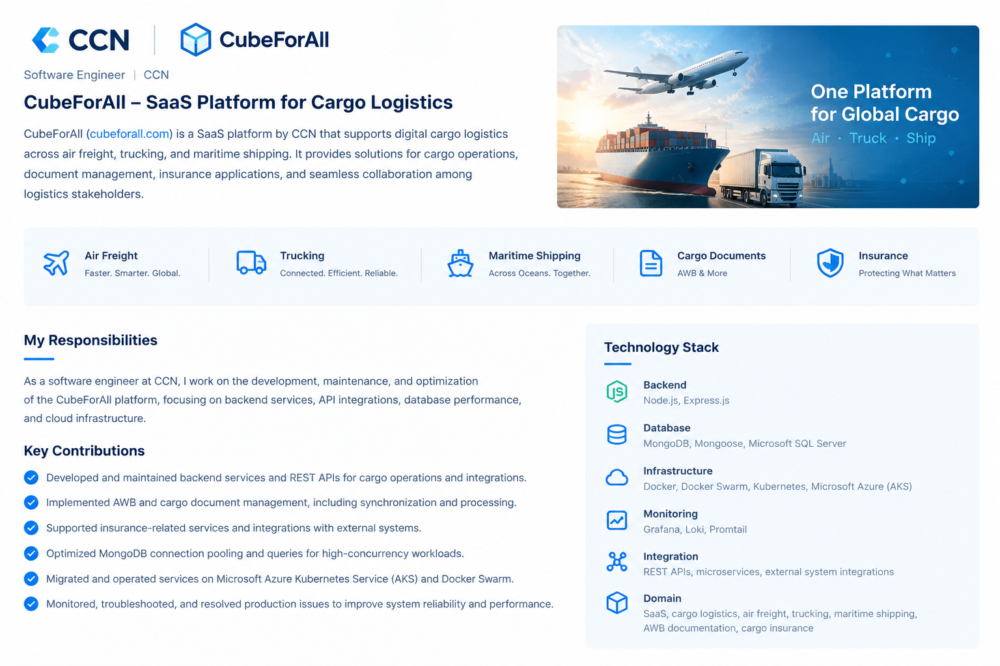
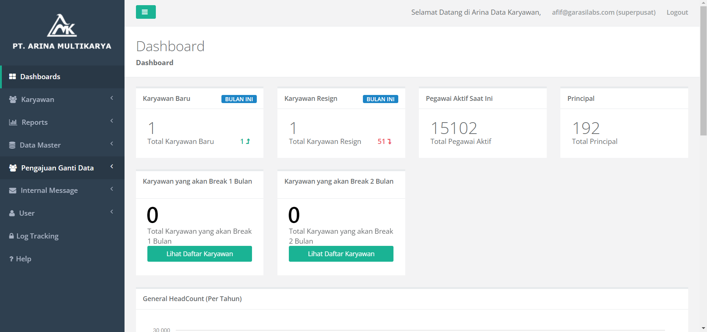
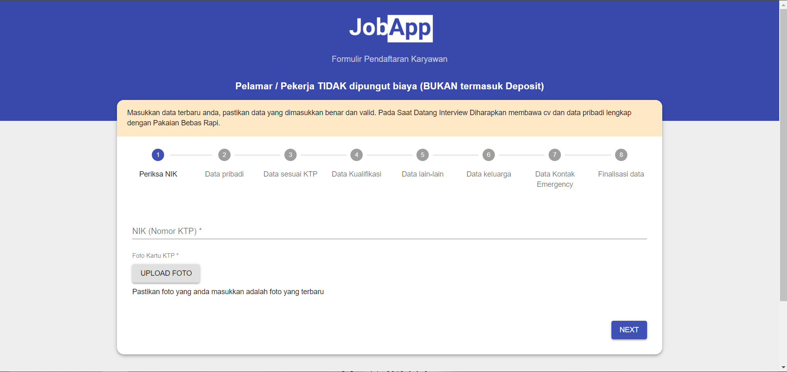
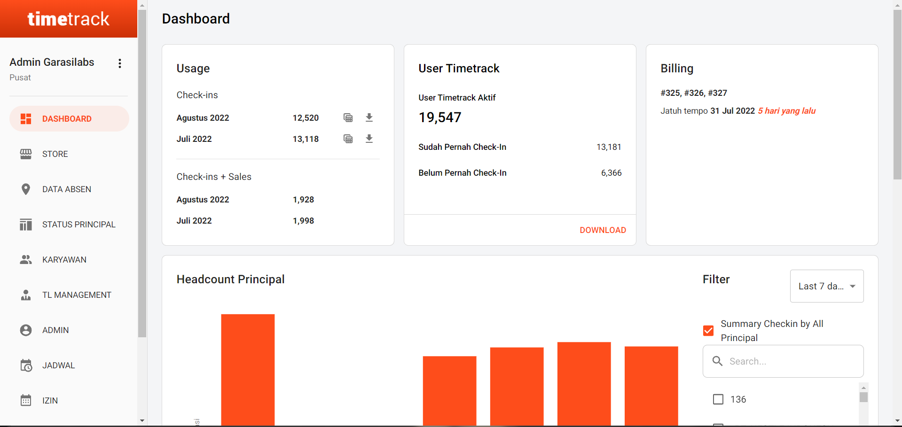
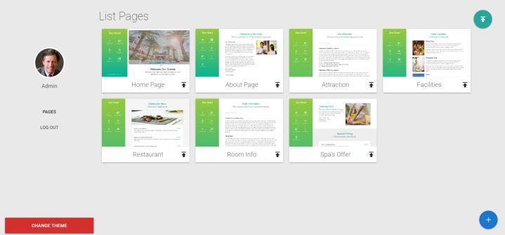
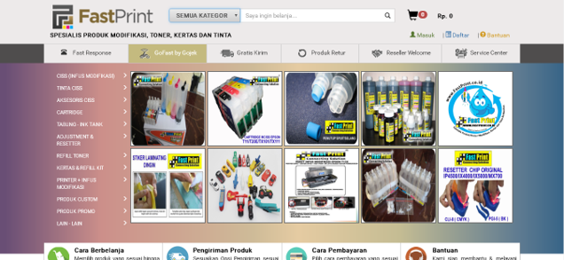

# Portfolio

Software Engineer focused on backend development with Node.js and MongoDB, building and maintaining web platforms, REST APIs, and cloud-deployed services.

**Core stack:** Node.js · JavaScript · React · MongoDB · PostgreSQL · SQL · Redis · Docker · Kubernetes · Azure DevOps

**Contact:** [LinkedIn](https://www.linkedin.com/in/afifjusuf) · [Email](mailto:afif-dev@outlook.com)

---

## Projects

### 1. CubeForAll SaaS Platform — CCN
**Role:** Software Engineer · **Live:** [cubeforall.com](https://cubeforall.com)

A SaaS platform for digital cargo logistics across air freight, trucking, and maritime shipping.

- Backend development and REST API integration
- AWB and cargo document processing
- Insurance-related service integrations
- MongoDB performance optimization
- Cloud infrastructure modernization with Docker, Kubernetes, and Microsoft Azure
- Production troubleshooting across distributed systems, with a focus on scalability and reliability

**Stack:** MERN · Azure DevOps · Docker Swarm · MongoDB · Redis

---

### 2. DB Arina — Garasilabs
**Live:** Private (client project)

Client-facing application that I maintain and extend.

- Built new features and edited existing ones based on client requests
- Fixed bugs and improved performance

**Stack:** Node.js · JavaScript · MongoDB

---

### 3. Job Applicant Website — Garasilabs
**Live:** Private (client project)

A job opportunities website built for a client of Garasilabs, covering the applicant flow of the recruitment process. I handle its maintenance and development.

**Stack:** Node.js · JavaScript · React · SQL · PostgreSQL · GraphQL

---

### 4. Timetrack — Garasilabs
**Live:** Private (client project)

An attendance management system where employees check in from an Android app. I maintain it and deliver new and updated features on client request.

**Stack:** Node.js · JavaScript · React · SQL · Responsive Design

---

### 5. Web CMS Builder — Personal Project
**Live:** Private (client project)

A drag-and-drop builder that lets users create web applications by arranging page elements, built with Node.js and SQLite.

**Stack:** Node.js · JavaScript · SQLite · SQL · Responsive Design · CMS

---

### 6. Online Shop Web - Fastprint
**Live:** Private (client project)

This project is a online shop web that created with CakePHP, Doctrine as a ORM, and MySQL as a database.
This project provide online purchase system like shopify.

**Stack:** SQL PHP · Responsive Design · Retail & Consumer Goods · Web Application · MySQL · CakePHP

---

> Some projects are client or company work, so source code is not public and screenshots may be redacted.
